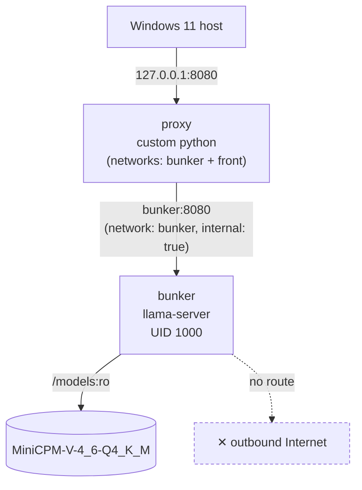

# Architecture

## Overview

Two services, two docker networks:

- **`bunker`** runs `ghcr.io/ggml-org/llama.cpp:server` with the MiniCPM-V
  model loaded, serving an OpenAI-compatible API on port 8080. It sits on
  the `bunker` network only, which is marked `internal: true` — the
  container has no route out to the internet or the host, and no ports
  are published for it in `compose.yaml`.
- **`proxy`** is a small custom Python reverse proxy (`proxy/app.py`). It
  sits on both the `bunker` network (to reach the model) and the `front`
  network, and is the only service with a published port
  (`127.0.0.1:8080:8080`). Every request to `bunker` goes through it.

## Why a proxy instead of publishing bunker's port directly

Two reasons:

1. **Isolation boundary.** The model container never needs an inbound
   route from anywhere except the proxy, and never needs an outbound
   route at all. Keeping it on an internal-only network means a
   compromised or malicious model/inference process has nothing to talk
   to.
2. **Request rewriting.** The proxy injects a `system` message with the
   live UTC date/time into every `/v1/chat/completions` request (see
   [decisions/003-local-proxy.md](decisions/003-local-proxy.md)). A plain
   TCP forwarder (the original `socat` setup) can't do this — it has no
   visibility into HTTP semantics, only bytes.

## Request flow

1. Client (curl, Continue, the llama.cpp web UI) sends a request to
   `http://127.0.0.1:8080`.
2. `proxy` receives it. If it's a POST to `/v1/chat/completions` (or
   `/chat/completions`), it parses the JSON body and inserts/merges a
   `system` message containing the current UTC date/time plus a note
   that the model has no internet access or tools.
3. `proxy` forwards the (possibly rewritten) request to `bunker:8080`
   over the internal network.
4. `bunker`'s llama.cpp server processes it and streams the response
   back, chunk by chunk, through `proxy` to the client.

The proxy is stateless — nothing is logged or persisted between requests.
