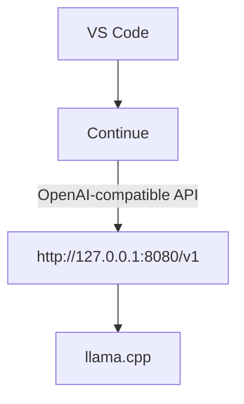

# Continue integration

[Continue](https://continue.dev) can talk to `bunker` directly, since
llama.cpp's server exposes an OpenAI-compatible API and `proxy` publishes
it on `127.0.0.1:8080`.



## Config

Copy
[config/continue.config.yaml.example](../config/continue.config.yaml.example)
to `~/.continue/config.yaml` (or merge it into your existing one). It
uses the `openai` provider — not a "local"/"llama.cpp"-specific
provider, since Continue doesn't have one. `provider` in Continue
selects the wire protocol to speak, not the actual company; `openai` is
the adapter for any OpenAI-compatible server, and `apiBase` points it at
this stack instead of OpenAI's real servers:

```yaml
models:
  - name: MiniCPM-V (local bunker)
    provider: openai
    model: MiniCPM-V-4_6-Q4_K_M.gguf
    apiBase: http://127.0.0.1:8080/v1
    apiKey: none
    defaultCompletionOptions:
      contextLength: 8192
      maxTokens: 512
    roles:
      - chat
      - edit
      - apply
```

Notes:

- **`bunker` only ever has one GGUF loaded at a time** (see
  [models.md](models.md#selecting-which-model-to-load)). llama.cpp
  ignores whatever `model` string a client sends and just answers with
  whatever's actually loaded. The example file lists an entry per
  available model, but only one should be uncommented at a time —
  matching whatever `MODEL_FILE` `bunker` was started with — or Continue
  will show a model picker where the "wrong" selection silently gets
  answered by a different model than its label claims.
- `apiKey` is a placeholder — the server has no `--api-key` set, so
  nothing actually authenticates, but Continue's schema wants the field
  present.
- `maxTokens: 512` caps generation so a request can't run indefinitely.
  Combined with `--reasoning off` on the server (see
  [models.md](models.md)), this budget is spent on visible output, not
  invisible chain-of-thought.
- This only works while `docker compose up` is running — specifically
  the `proxy` service, since that's what's bound to `127.0.0.1:8080`.

## Performance expectations

CPU-only inference, measured on this machine at `Q4_K_M`:

| Model | Prompt tok/s | Generation tok/s |
| --- | --- | --- |
| MiniCPM-V-4.6 | ~65–88 | ~13–15 |
| Hermes-3-Llama-3.1-8B | ~8 | ~3 |

Model size matters far more than any config tweak here — swapping to an
8B model drops generation speed by roughly 5x compared to MiniCPM-V.
Factor that into which model you pick for interactive use versus
something you can wait longer on.

Agent mode in Continue sends
substantial system-prompt/tool-schema overhead on every request (often
1000+ tokens even for a short message), which dominates latency more
than the visible reply length does. For faster local chat:

- Prefer plain **Chat mode** over **Agent mode** when you don't need
  Continue's tools (file edit, terminal, etc.) — Agent mode's tool
  schemas add most of the per-request overhead.
- Avoid `@codebase` / `@docs` context providers with this model unless
  necessary; each one adds retrieved text to the prompt.
- Keep conversations short — Continue resends the full history each
  turn.

## Known gotcha: tool-call prompts

If a chat message triggers something like "Allow use of `get_datetime`
from Browser Tools?", see
[troubleshooting.md](troubleshooting.md#the-model-keeps-asking-to-call-a-tool).
That specific case turned out to be llama.cpp's *own* built-in web UI
tool settings, not Continue — but the same failure mode (a tool schema
being offered contradicts a text instruction saying "no tools
available") can happen with any agentic client, including Continue's
own tool set.
